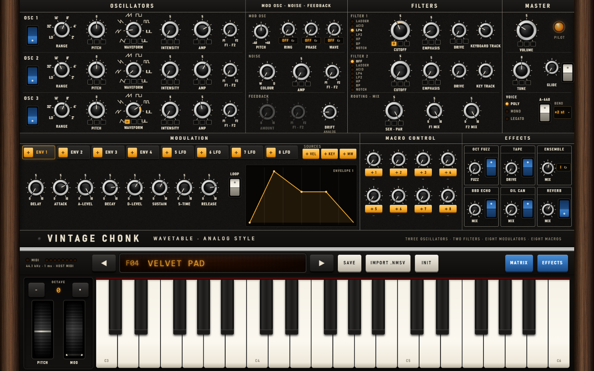
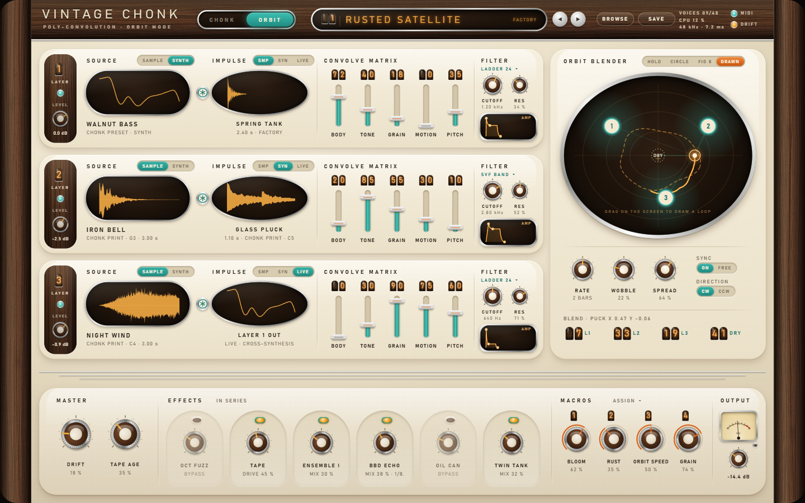

# Vintage Chonk

A warm, modern-classic synthesizer: a VST3 instrument and standalone app for Windows, built from an original
sound engine and a 1970s-style panel, with a second engine, **ORBIT**, for poly-convolution sound design (new in
1.1.0). It also converts Native Instruments Massive presets (`.nmsv`) into its own sounds.



## Features

* **3 oscillators** with eight classic analogue-style waveforms (triangle, "shark", reverse saw, saw, square
  and three pulses), footage ranges 64' to 1', fine tune and a phase-bend intensity.
* **Mod oscillator** for ring, phase and wave-position modulation; **noise** with colour.
* **2 filters**: LADDER (24 dB transistor ladder), ACID (303-style diode ladder), LP4, LP2, HP, BP, NOTCH;
  serial, parallel or anything between.
* **4 envelopes** with delay, attack level, decay level, sustain time and loop.
* **4 modulators**, each an LFO, a 16-step Performer (32 curve shapes) or a 16-step Stepper; 16 modulation
  routings, 8 macros, velocity, key, mod wheel, aftertouch, bend and random as sources.
* **6 effects** in a fixed chain: OCT FUZZ, TAPE, ENSEMBLE, BBD ECHO, OIL CAN, REVERB (TWIN TANK or SPRING);
  both echoes can sync to the host tempo.
* **16 voices**, poly / mono / legato, glide.
* **16 factory presets** as host programs (plus the 8 ORBIT presets); your own presets saved by name.
* **22 automatable host parameters** (8 macros, master, filter cutoffs and emphasis, mod osc, effect levels,
  glide); full state saved with the DAW project.
* **IMPORT .NMSV**: converts Native Instruments Massive (original, not Massive X) presets on the spot, with a
  report of what carried over. The converter also exists as a single offline web page
  (`editor/converter.html`) and as a Python tool (`tools/preset_converter/convert.py`).
* Any sample rate and block size: the engine runs at 44.1 kHz with a high-quality resampler; output does not
  depend on the host's block size; 1.5-2.2 ms latency, reported to the host.


## ORBIT (new in 1.1.0)

ORBIT is an original poly-convolution / cross-synthesis engine: three layers, each a source (a sample, or a
Vintage Chonk synth voice) combined with an impulse (a sample, a generated impulse, a printed synth sound, or
another layer playing live) along five separate dimensions:

* **BODY**: true convolution: the impulse's resonance and space.
* **TONE**: the impulse's colour (spectral envelope) only.
* **GRAIN**: the impulse's texture and fine structure only.
* **MOTION**: the impulse's loudness contour and transients.
* **PITCH**: the impulse's partials re-tuned to the played note.

An orbit blender mixes the layers and the dry sound with a puck that holds still, circles, traces a figure of
eight or follows a loop you draw; 32 modulation slots, 4 macros, drift, tape age and the six effects. Samples
(WAV, AIFF, FLAC) are dragged onto the panel and saved inside the DAW project. 8 factory presets (host programs
17-24), 42 automatable parameters, latency 347 samples at 48 kHz, reported to the host. Projects from 1.0.0 open
unchanged in CHONK mode. Technical overview: `docs/ORBIT_MODE.md`; renders of the presets:
`examples/orbit/presets/`.



The full user guide is `docs/guide/Vintage-Chonk-User-Guide.pdf`. It also covers the same engine as
replacement firmware for the M-VAVE FM-1 keyboard and as an Android tablet app; those two builds live outside
this repository (the FM-1 firmware depends on M-VAVE's SDK).

## Build the VST3 and the standalone app (Windows x64)

Needs: Visual Studio 2022 Build Tools (MSVC, Windows SDK 10.0.26100), git, LLVM for Windows (`clang-cl.exe`
in `C:\Program Files\LLVM`, or set `MFE_CLANG_CL`), and optionally node (regenerates the factory bank header).

```powershell
git clone <this repository> vintage-chonk
cd vintage-chonk
powershell -ExecutionPolicy Bypass -File plugin\build.ps1 -Test
```

`plugin\build.ps1` first runs `plugin\fetch_deps.ps1`, which downloads the third-party code at pinned versions
and checks each by commit or SHA-256: JUCE 8.0.15 (with one small patch, see `plugin/patches/`) and Microsoft's
WebView2 SDK 1.0.4314.35. Output: `plugin\dist\Vintage Chonk.vst3` and the standalone `plugin\dist\Vintage Chonk.exe`. Install it by copying that folder into
`C:\Program Files\Common Files\VST3\` (admin), then rescan plugins in your DAW. Details, the host test and
Steinberg's validator: `plugin/README.md`.

## Other tests

```powershell
powershell -ExecutionPolicy Bypass -File run_tests.ps1    # engine and ORBIT core (C), converter (Python), web pages (node)
```

The C tests need gcc or clang; the page tests use headless Chrome when it is installed.

## Repository layout

| Folder | What |
|---|---|
| `dsp/` | the sound engine (C11, integer and float paths, no allocation); `dsp/orbit/` the ORBIT core |
| `plugin/` | the VST3 plugin (JUCE 8), build and fetch scripts, JUCE patch, host test |
| `panel/` | the web panel (HTML/CSS/JS) shown in the plugin window |
| `editor/` | the browser preset converter (one offline HTML file, built from `editor/src`) |
| `tools/` | `.nmsv` reader, preset converter, offline renderer, table generator, page builders |
| `tests/` | engine, sequencer, ORBIT, converter and page tests; synthetic test presets |
| `docs/guide/` | the user guide (HTML sources, pictures, PDF) |
| `examples/` | a few short demo renders and their presets; the ORBIT factory preset renders |

## Licence

Vintage Chonk is free software under the GNU Affero General Public License v3 (`LICENSE`), because the
plugin links JUCE under its AGPLv3 option. Third-party code, fonts and trademarks: `NOTICE`.

Native Instruments and Massive are trademarks of Native Instruments GmbH; M-VAVE and FM-1 belong to their
owner; VST is a trademark of Steinberg Media Technologies GmbH. Vintage Chonk is an independent project, not
affiliated with or endorsed by them. No Native Instruments software, presets or wavetables are included.
